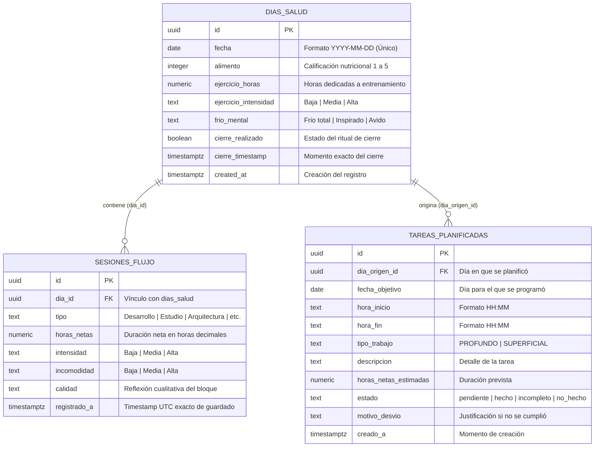

# DiaCaminante — Manual Técnico y Arquitectura del Sistema
**Sistema Integral de Auditoría de Concentración Profunda, Desconexión Cognitiva y Disciplina Diaria**

---

## 1. Visión General del Proyecto

**DiaCaminante** es una aplicación web de alto rendimiento orientada a la autodisciplina y la productividad radical, fundamentada en los principios de **Deep Work** (*Cal Newport*), dureza mental (*David Goggins*) y filosofía estoica (*Marco Aurelio, Séneca, Epicteto*).

Su diseño parte de una premisa psicológica fundamental: **el pasado no justifica la inercia del presente**. Por ello, el marcador principal de la aplicación se **resetea a cero cada amanecer**, forzando al usuario a conquistar el día actual sin refugiarse en logros pasados. Paralelamente, dispone de una **Bóveda Histórica en ventana modal independiente** que permite auditar cualquier día pasado al minuto exacto, con su cronograma de 24 horas y sus reflexiones cualitativas.

### Stack Tecnológico
- **Framework Web**: [Astro 5](https://astro.build/) en modo SSR (`output: 'server'`).
- **Adaptador de Despliegue**: `@astrojs/cloudflare` ejecutándose sobre **Cloudflare Pages / Workers**.
- **Capa API / Servidor**: [Hono.js](https://hono.dev/) montado en `/api/[...path]` con acceso al runtime `env` de Cloudflare.
- **Base de Datos**: PostgreSQL gestionado en la nube mediante **Supabase** (`@supabase/supabase-js`).
- **Librería de UI**: [React 19](https://react.dev/) hidratado selectivamente con directivas Astro (`client:load`).
- **Estilos y Diseño**: [Tailwind CSS](https://tailwindcss.com/) bajo la paleta temática *«Oscuro Pastel de Medianoche»* (Midnight #090C10, Pastel Lavender #C4B5FD, Mint #86EFAC, Coral #FDA4AF, Amber #FDE68A, Ice #93C5FD).

---

## 2. Esquema de Base de Datos (Supabase / PostgreSQL)

El modelo relacional consta de tres tablas principales optimizadas para auditoría temporal e integridad relacional:



### Detalle de Campos y Reglas de Negocio en la Base de Datos

1. **`dias_salud`**:
   - Cada fila representa una jornada única (`fecha` en formato `YYYY-MM-DD`).
   - `cierre_realizado`: Indica si el usuario formalizó el Ritual de Cierre antes de las 11:59 PM. Si cruza la medianoche sin sellarse, el sistema ejecuta un **auto-cierre preventivo** marcando el timestamp correspondiente.
   - `alimento` (1-5), `ejercicio_horas` y `frio_mental`: Recogen la tríada biológica indispensable para sostener la concentración de alto rendimiento.

2. **`sesiones_flujo`**:
   - Registra cada bloque atómico de concentración profunda ejecutado.
   - `horas_netas`: Tiempo efectivo de trabajo libre de interrupciones o distracciones.
   - `intensidad`: Profundidad de inmersión (`Alta`: foco radical; `Media`: concentración sostenida; `Baja`: trabajo mecánico o de soporte).
   - `incomodidad`: Grado de resistencia cognitiva o dificultad percibida (`Alta`: frontera de aprendizaje / dolor cognitivo; `Media`: desafío activo; `Baja`: zona de confort).
   - `calidad`: Campo de texto libre donde el usuario escribe su reflexión sincera sobre lo alcanzado, dificultades o frustraciones del bloque.
   - `registrado_a`: Timestamp ISO 8601 que fija el momento exacto en que concluyó y se guardó la sesión.

3. **`tareas_planificadas`**:
   - Gestiona la agenda proactiva y precompromisos diarios de Newport.
   - `tipo_trabajo`: Diferencia el trabajo profundo (`PROFUNDO`) del trabajo administrativo o trivial (`SUPERFICIAL`).
   - `estado`: `pendiente`, `hecho`, `incompleto` o `no_hecho`.
   - `motivo_desvio`: Fuerza una rendición de cuentas honesta cuando una tarea no se concluye según lo planificado.

---

## 3. Endpoints del Backend (`src/server/app.ts`)

La API está construida con **Hono.js** e inyecta dinámicamente las credenciales seguras de Supabase en el runtime de Cloudflare Pages (`context.locals.runtime.env`):

| Método | Endpoint | Parámetros | Descripción |
| :--- | :--- | :--- | :--- |
| `GET` | `/api/dia/hoy` | `fecha` (opcional) | Obtiene o inicializa la jornada actual, sus sesiones y tareas. Ejecuta auto-cierre de días pasados pendientes. |
| `POST` | `/api/sesiones` | Body: `{ tipo, horas_netas, intensidad, incomodidad, calidad, fecha }` | Registra un nuevo bloque de foco en `sesiones_flujo` asignándolo al día correspondiente. |
| `PUT` | `/api/sesiones/:id` | Body: campos editados | Permite editar en caliente tipo, horas, intensidad, incomodidad o notas de un bloque existente. |
| `DELETE` | `/api/sesiones/:id` | URL param `id` | Elimina permanentemente una sesión de flujo y recalcula el marcador diario. |
| `PUT` | `/api/tareas/:id` | Body: `{ estado, motivo_desvio, ... }` | Actualiza el estado o justificación de desvío de una tarea planificada. |
| `POST` | `/api/cierre` | Body: `{ fecha, alimento, ejercicio_horas, ejercicio_intensidad, frio_mental }` | Sella formalmente el Ritual de Cierre diario en `dias_salud` con timestamp exacto. |
| `GET` | `/api/estadisticas` | `fecha` (opcional) | Computa las métricas aisladas de hoy, la matriz de calidad 3x3, la racha élite, el histórico continuo de 30 días y el listado de días activos. |
| `GET` | `/api/dia/historico` | `fecha=YYYY-MM-DD` | Consulta el detalle íntegro de **cualquier fecha pasada** (sesiones, tareas, hábitos, cierre) **sin crear filas ficticias** en la BD. |
| `GET` | `/api/exportar` | Ninguno | Descarga un snapshot JSON completo y portable de toda la base de datos para respaldo y auditoría offline. |

---

## 4. Qué Registramos: Parámetros y Filosofía de Captura

El sistema captura tres capas de información en cada jornada:

```
                                  JORNADA DIARIA
                                         │
         ┌───────────────────────────────┼───────────────────────────────┐
         ▼                               ▼                               ▼
    CAPA COGNITIVA                  CAPA BIOLÓGICA                  CAPA ESTRATÉGICA
 (Sesiones de Foco)             (Hábitos Psicofísicos)           (Cierre y Auditoría)
 ├─ Horas netas reales          ├─ Calidad nutricional (1-5)     ├─ Ritual de Cierre formal
 ├─ Tipo de trabajo             ├─ Horas de entrenamiento        ├─ Timestamp de desconexión
 ├─ Nivel de Intensidad         ├─ Intensidad deportiva          ├─ Revisión de tareas
 ├─ Nivel de Incomodidad        └─ Frío Mental psicológico       └─ Racha Élite rigurosa
 └─ Reflexión cualitativa
```

1. **Horas Netas de Concentración**: Solo se computa el tiempo en que la atención estuvo enfocada en una única tarea sin multitarea ni distracciones.
2. **Matriz de Calidad (Intensidad × Incomodidad)**: Cruza el grado de inmersión con el nivel de desafío intelectual, categorizando las horas en:
   - **Élite** (Alta × Alta): Frontera de habilidad y máximo impacto.
   - **Flujo** (Alta × Media): Máxima productividad sostenida.
   - **Mecánico** (Alta × Baja): Trabajo enfocado pero de baja complejidad.
   - **Desafío** (Media × Alta): Aprendizaje difícil con esfuerzo visible.
   - **Superficial** (Baja × Baja): Tareas de bajo valor cognitivo.
3. **Reflexiones Sinceras**: Textos donde se desahoga y audita el verdadero estado de avance y el diálogo mental interno.
4. **Tríada Biológica**: Alimentación limpia, estímulo físico obligatorio (≥45 min) y templanza psicológica (`Frio total`, `Inspirado`, `Avido`).
5. **Ritual de Cierre (Shutdown Ritual)**: Límite estricto al anochecer para evitar bucles cognitivos residuales (*efecto Zeigarnik*).

---

## 5. Qué Mostramos en la Web: Módulos y Funcionamiento Visual

La interfaz se divide en **tres pestañas principales** más un **modal emergente de histórico** y un **modal diario de sabiduría**:

### A. Vista Principal: Estadísticas de la Jornada (`VisualStats.tsx`)
Diseñada para dar feedback implacable sobre la jornada en curso:

1. **Cabecera Temporal en Vivo**:
   - **Reloj Digital en Tiempo Real**: Muestra la hora exacta `HH:MM:SS` actualizándose cada segundo.
   - **Día del Ciclo Anual**: Distintivo `Día X de 365 días` (iniciado el 2 de noviembre de 2026 como Día 1), junto al porcentaje anual transcurrido y los días restantes.
   - **Barra de Progreso de 24 Horas**: Visualiza qué porcentaje del día actual ha pasado y cuántas horas/minutos faltan con exactitud para el cierre de las 23:59.
   - **Insignia de Racha Élite en la Esquina**: Racha estricta que **solo se acumula si el día cumple el 75% en todos los pilares** (≥2.25h deep work, ≥37.5% incomodidad, ≥0.55h entreno y cierre formal).
   - **Botón `🏛️ Ver Histórico`**: Abre la ventana modal independiente.

2. **4 Tarjetas KPI de HOY (Sin Arrastre Histórico)**:
   - **Horas Netas de Hoy**: Progreso hacia el estándar mínimo de Cal Newport (3.0h).
   - **Fricción Mental de Hoy**: Porcentaje en incomodidad Alta/Media (mínimo 50%).
   - **Entrenamiento de Hoy**: Horas de ejercicio físico (mínimo 0.75h / 45 min).
   - **Ritual de Cierre**: Estado actual (`Sellado` con check o `Abierto` antes de 11:59 PM).

3. **Cronograma Gráfico de 24 Horas de Hoy (00:00 — 23:59)**:
   - Pista visual interactiva con las **24 horas del día**:
     - Altura de barra según los minutos netos de concentración en esa hora (0 a 60 min).
     - Color de barra según Intensidad: Menta pastel (*Alta*), Ámbar (*Media*), Hielo (*Baja*).
     - Punto superior según Incomodidad: Coral pastel (*Alta*), Ámbar (*Media*), Hielo (*Baja*).
     - Marcador parpadeante en tiempo real: **`📍 AHORA`** sobre la hora en curso.
   - **Inspector Horario Interactivo**: Al hacer clic en cualquier hora, despliega la tarjeta con horario exacto, minutos de foco, diagnósticos y el listado de bloques ejecutados con sus notas cualitativas.

4. **Semáforo de Exigencia & Disciplina Diaria**:
   - Evalúa en tiempo real los 4 pilares obligatorios y emite alertas estrictas cuando hay déficit, acompañadas de citas autorales clásicas:
     - *Déficit de Deep Work* → Alerta con cita de **Séneca** (*De la brevedad de la vida*).
     - *Confort Intelectual Excesivo* → Alerta con cita de **Brian Tracy** (*Trágate ese sapo*).
     - *Templo Físico sin Entrenar* → Alerta con cita de **David Goggins** (*Can't Hurt Me*).
     - *Cierre Pendiente* → Alerta con cita de **Marco Aurelio** (*Meditaciones*).
   - Si se conquistan todos los umbrales, se ilumina el banner dorado de **Victoria Élite** con cita de **Aristóteles**.

5. **Calidad Cognitiva de Hoy**:
   - Barras de espectro proporcional para Incomodidad e Intensidad.
   - **Matriz 2D de la Jornada (3×3)** en tiempo real.

---

### B. Ventana Flotante / Modal: Bóveda Histórica Consolidada
Se abre de forma modal (`fixed inset-0 z-50` con backdrop blur y tecla `Escape`), **sin mezclarse ni interferir con la página de hoy**:

1. **Auditoría de Día Específico (Con Hora y Todo)**:
   - **Selector de Fecha**: Selector de calendario (`input type="date"`) y botones `◀ Anterior` / `Siguiente ▶`.
   - **Píldoras de Acceso Rápido**: Botones directos a cada fecha histórica con actividad registrada (ej. `22/10 (3.5h)`, `02/11 (Día 1)`, `03/11 (Hoy)`).
   - **Clic en el Gráfico**: Hacer clic en cualquier barra del gráfico de tendencia selecciona inmediatamente esa fecha.
   - **Detalle de la Jornada Seleccionada**:
     - Fecha formal y correspondencia con el ciclo de 365 días.
     - Resumen de Deep Work, entreno físico, calificación nutricional y hora de sellado del cierre.
     - **Cronograma Gráfico de 24 Horas de ese Día Histórico**: Mapea visualmente las 24 horas de esa jornada pasada.
     - **Listado Completo de Bloques con Horario Exacto**:
       - **Rango horario calculado de trabajo**: ej. `🕒 Horario: 17:41 — 21:11` (`3.5h / 210 min netos`).
       - **Hora exacta de guardado en base de datos**: ej. `💾 Registrado a las 21:11:47`.
       - Tipo de trabajo, nivel de intensidad y nivel de incomodidad.
       - **Reflexión Cualitativa (`calidad`)**: Destacada en un bloque de lectura con comillas para auditar los pensamientos del usuario en esa sesión.
     - **Tareas Planificadas de ese Día**: Horario previsto, estado final y motivos de desvío.

2. **Macrométricas y Tendencias Acumuladas**:
   - Total histórico de horas netas, promedio diario activo, racha máxima élite histórica y tasa de cierre global.
   - Gráfico de barras continuas con filtros para **7, 14 y 30 días**.
   - Matriz 2D de calidad histórica acumulada (3×3).
   - Distribución histórica por tipo de trabajo y hábitos psicofísicos globales.

---

### C. Registro Diario (`Scoreboard.tsx` & `QuickLog.tsx`)
- **Scoreboard Superior**: Visualiza el total de horas de hoy, estado de cierre y botón para lanzar el modal de desconexión.
- **Formulario QuickLog**: Diseñado para registrar sesiones en menos de 15 segundos:
  - Botones predeterminados de tipo (`Desarrollo`, `Estudio`, `Arquitectura`, `Escritura`) o personalizado.
  - Incrementadores rápidos de tiempo (`+0.5h`, `+1.0h`, `+1.5h`).
  - Selectores de Intensidad e Incomodidad.
  - Campo de notas cualitativas.
  - Atajo de teclado: `Ctrl` + `Enter` para guardar instantáneamente.
- **Línea de Tiempo de Hoy Editable**:
  - Cada bloque registrado cuenta con botones de **Editar** (modifica horas, tipo, intensidad o notas inline) y **Eliminar** (con confirmación de seguridad).

---

### D. Sabiduría & Filosofía (`PhilosophyView.tsx` & `DailyReflectionModal.tsx`)
- **Dataset de 365 Reflexiones Únicas**:
  - Una reflexión para cada día del año, variada e intercalada entre 9 fuentes de sabiduría universal:
    1. **David Goggins** (*Can't Hurt Me* - Dureza mental y superación del 40%).
    2. **Marco Aurelio** (*Meditaciones* - Deber humano y dominio mental).
    3. **Jesús de Nazaret** (*Evangelios* - Enfoque sincero, paciencia y pureza de intención).
    4. **Brian Tracy** (*Trágate ese sapo* - Vencer la procrastinación y acción matutina).
    5. **Buda Gautama** (*Dhammapada* - Dominio de la mente y desapego de distracciones).
    6. **Séneca** (*Cartas a Lucilio* - Brevedad de la vida y valor del tiempo).
    7. **Napoleon Hill** (*Piense y hágase rico* - Propósito definido y persistencia).
    8. **Epicteto** (*Enquiridión* - Dicotomía del control).
    9. **John D. Rockefeller** (*Titán / Principios* - Precisión, contabilidad rigurosa y disciplina financiera).
- **Despertar Matutino Automático**:
  - Al abrir la web por primera vez cada día, se abre automáticamente el modal con la reflexión correspondiente al día del ciclo.
  - Incluye botón **«🎲 Cambiar Frase»** para explorar reflexiones aleatorias.
- **Biblioteca Completa**: En la pestaña *Filosofía & Disciplina*, el usuario puede buscar por palabras clave, filtrar por categoría y consultar las 365 reflexiones en cualquier momento.

---

## 6. Flujo de Trabajo Diario Recomendado

```
07:00 AM ──▶ Despertar & Apertura de la Web
             └─ Lectura de la Reflexión del Día (Modal Sabiduría)
             └─ El marcador está limpio en 0.0h (Inicio de combate diario)

08:30 AM ──▶ Bloque 1 de Deep Work (ej. 1.5h en Desarrollo / Incomodidad Alta)
             └─ Registro en QuickLog con notas cualitativas (Atajo: Ctrl + Enter)
             └─ El cronograma de 24h pinta la barra correspondiente en color Menta

02:00 PM ──▶ Bloque 2 de Deep Work (ej. 1.5h en Arquitectura)
             └─ Superación de la meta de 3.0h netas de Cal Newport

06:00 PM ──▶ Entrenamiento Físico (≥45 minutos)

09:30 PM ──▶ Ritual de Cierre Formal (Shutdown Ritual)
             └─ Registro de alimentación, ejercicio e indicador psicológico
             └─ Revisión de tareas y sellado formal de la jornada
             └─ Mente completamente liberada hasta el día siguiente
```

---

## 7. Mantenimiento y Extensibilidad

- **Variables de Entorno**: Gestionadas a través de `SUPABASE_URL` y `SUPABASE_SERVICE_ROLE_KEY` en Cloudflare Pages.
- **Cero Dependencia de Red Local**: Toda la lógica crítica corre en edge SSR con polyfill de `MessageChannel` inyectado para compatibilidad con React 19.
- **Auditoría Offline**: Exportable vía `/api/exportar` para copias de seguridad en formato JSON.
